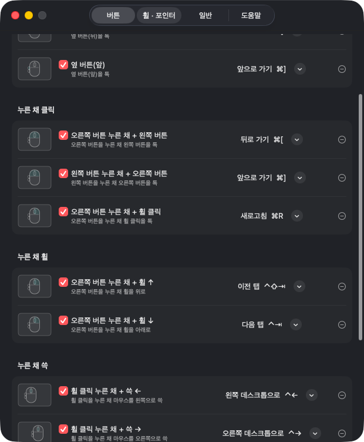

<p align="center"></p>

# 🖱 콕콕 (KokKok) — 맥 마우스 버튼 · 휠 커스텀

**버튼을 누른 채 톡, 누른 채 휠, 누른 채 쓱.** 옆 버튼으로 뒤로 · 앞으로, 우클릭 누른 채 휠로 탭 전환, 휠 누른 채 쓱으로 데스크톱 전환 — 체크하고 동작만 고르면 돼요. 트랙패드용 [톡톡](https://github.com/hanseolhui/toktok)의 마우스 버전이에요.

- ⬇️ **다운로드 (애플 공증):** [최신 릴리스](https://github.com/hanseolhui/kokkok/releases/latest) · `brew install --cask hanseolhui/tap/kokkok`
- 유니버설 (애플 실리콘 + 인텔) · macOS 13 이상 · 무료

## 🚀 설치

**방법 1. 다운로드** — [최신 릴리스](https://github.com/hanseolhui/kokkok/releases/latest)에서 `KokKok.zip` 받기 → 압축 풀고 `KokKok.app`을 **응용 프로그램** 폴더로 옮긴 뒤 실행

**방법 2. Homebrew**

```bash
brew install --cask hanseolhui/tap/kokkok
```

**방법 3. 터미널 한 줄**

```bash
bash -c "$(curl -fsSL https://raw.githubusercontent.com/hanseolhui/kokkok/main/install.sh)"
```

**처음 한 번: 손쉬운 사용 권한 허용**
시스템 설정 → 개인정보 보호 및 보안 → **손쉬운 사용** → KokKok 켜기

## 🖱 할 수 있는 것

| 조합 | 기본 동작 |
|---|---|
| 옆 버튼(뒤) · 옆 버튼(앞) | 뒤로 가기 · 앞으로 가기 |
| 오른쪽 버튼 누른 채 + 왼쪽 버튼 | 뒤로 가기 |
| 왼쪽 버튼 누른 채 + 오른쪽 버튼 | 앞으로 가기 |
| 오른쪽 버튼 누른 채 + 휠 ↑ ↓ | 이전 탭 · 다음 탭 |
| 오른쪽 버튼 누른 채 + 휠 클릭 | 새로고침 |
| 휠 클릭 누른 채 + 쓱 ← → ↑ ↓ | 데스크톱 전환 · Mission Control · 앱 창 모아 보기 |
| ➕ 나만의 조합 | 설정에서 **추가…** → 마우스로 직접 해 보면 그대로 등록 (⌘⌥⌃⇧ 키 조합도) |

동작은 톡톡과 같은 40여 개(탭 · 창 정렬 · 데스크톱 · 음악 …)에 단축키 입력 · 앱 실행 · 단축어 실행까지 고를 수 있어요.

**휠 · 포인터**
- 부드러운 스크롤 (한 칸 거리 · 부드러움 · 가속 조절) — 트랙패드 · 매직 마우스는 그대로
- 휠 방향 윈도우처럼 (마우스만)
- 포인터 속도 · 가속 끄기 (마우스만)

**다른 마우스 앱 점검** — Logi Options+ · LinearMouse · Mos 등이 함께 켜져 있으면 알려 주고 끌 수 있어요 (같은 버튼을 두 앱이 쓰면 두 번 실행되거나 휠 방향이 두 번 뒤집혀요).

<p align="center"></p>

## 🗑 삭제

메뉴바 아이콘 → **콕콕 종료** 후 응용 프로그램 폴더에서 `KokKok.app` 삭제 (Homebrew: `brew uninstall --cask kokkok`)

---

© 2026 SeoriArts (서리아트) · [LICENSE](LICENSE)
